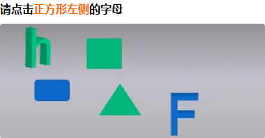
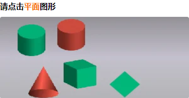
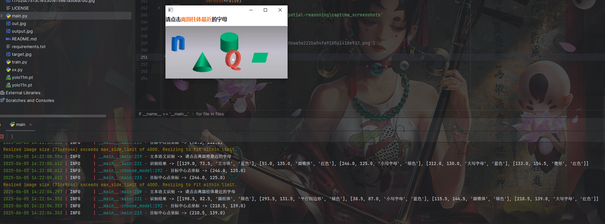
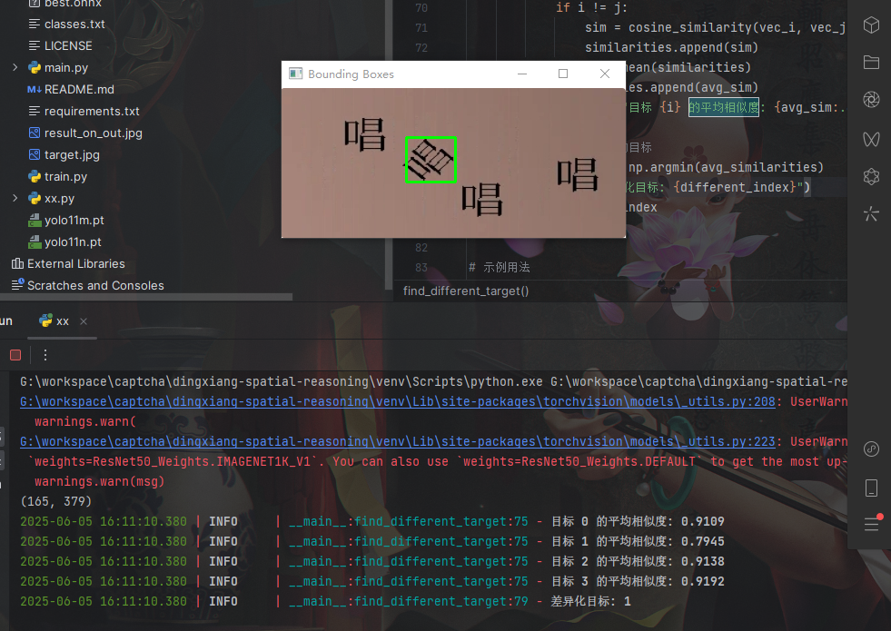

# 顶象空间推理验证码，项目包含模型与语义识别代码

### Prepare

+ CUDA device with mem>=16G for training (reduce the batch size if necessary)

+ Python>=3.9,<3.13

+ PyTorch>=2.0

+ Clone the repository.
```shell
pip install -r requirements.txt
```
## 项目分为两部分，第一部分目标检测，第二部分语义识别

### 第一部分，目标检测


把训练的图片保存在[datasets](siamese_dataset)文件夹下面
```
datasets
   train
     images
        2F2dc64a9cc7f3332fd004b06e07f16b46.jpg
        2F3bcd7102230f2425b63ca78e7be88da4.jpg
     labels
        2F2dc64a9cc7f3332fd004b06e07f16b46.txt
        2F3bcd7102230f2425b63ca78e7be88da4.txt
     .....
   val
     images
        7eaefcb3e9cb076b4cb7ca609c99ea47.jpg
        9a99c0e535be554414457c0818731c70.jpg
     labels
        7eaefcb3e9cb076b4cb7ca609c99ea47.txt
        9a99c0e535be554414457c0818731c70.txt
   cooc.yaml
     .....
```
#### cooc.yaml
```yaml
path: G:/workspace/captcha/dingxiang-spatial-reasoning/datasets  # 数据集根目录
train: train/images  # 相对路径
val: val/images    # 相对路径

# 类别配置
nc: 17
names: ["矩形","五角星形","五边形","三角形","圆柱体","圆锥体","球体","圆角矩形","六边形","正方体","小写字母","大写字母","正方形","梯形","平行四边形","菱形","圆形"]
```
#### 启动训练
    train.py 文件

### 第二部分，语义识别

#### 使用飞桨识别
```python
from paddleocr import PaddleOCR
ocr = PaddleOCR(
        use_doc_orientation_classify=False,
        use_doc_unwarping=False,
        use_textline_orientation=False,
        ocr_version='PP-OCRv5',
    )
result = ocr.predict(
    input='target.jpg')
# result = ocr.predict(
#     input=image)
# 可视化结果并保存 json 结果
valid_texts = []
for res in result:
    valid_texts.extend(res['rec_texts'])
    # res.save_to_img("output")
    # res.save_to_json("output")
return ''.join(valid_texts)
```
#### 模式判断示例
  
```python
# info=(centre_x,centre_y,model.names[class_id],color)
def choose_model(text, infos):
    res_point = (0, 0)
    if "大写" in text:
        for info in infos:
            if info[2] == "大写字母":
                res_point = (info[0], info[1])
                break
    elif "小写" in text:
        for info in infos:
            if info[2] == "小写字母":
                res_point = (info[0], info[1])
                break
    elif "请点击平面图形" in text:
        for info in infos:
            if info[2].endswith("形"):
                res_point = (info[0], info[1])
                break
    elif "请点击立体图形" in text:
        for info in infos:
            if info[2].endswith("体"):
                res_point = (info[0], info[1])
                break
    elif "左侧的" in text:
        index = text.index("左侧的")
        origin = text[3:index]
        target = text[index + 3:]
        if origin == "球":
            origin = "球体"
        logger.info(f"origin: {origin}, target: {target}")
        target_points = []
        for info in infos:
            if origin == info[2] or origin in info[2]:
                origin_point = (info[0], info[1])
            elif "字母" in info[2]:
                target_points.append((info[0], info[1]))
        for target_point in target_points:
            if target_point[0] < origin_point[0]:
                res_point = target_point
                break
    elif "右侧的" in text:
        index = text.index("左侧的")
        origin = text[3:index]
        target = text[index + 3:]
        if origin == "球":
            origin = "球体"
        logger.info(f"origin: {origin}, target: {target}")
        target_points = []
        for info in infos:
            if origin == info[2] or origin in info[2]:
                origin_point = (info[0], info[1])
            elif "字母" in info[2]:
                target_points.append((info[0], info[1]))
        for target_point in target_points:
            if target_point[0] > origin_point[0]:
                res_point = target_point
                break
    elif "与" in text:
        index = text.index("与")
        origin = text[3:index]
        target = text[index + 1:-5]
        logger.info(f"origin: {origin}, target: {target}")
        target_color = ""
        for info in infos:
            if target == info[2] or target in info[2]:
                target_color = info[3]
                break
        for info in infos:
            if info[3] == target_color and target not in info[2]:
                res_point = (info[0], info[1])
                break
    elif '离' in text:
        index = text.index("最近的")
        origin = text[4:index]
        target = text[index + 3:]
        for info in infos:
            if origin == info[2] or origin in info[2]:
                target_point = (info[0], info[1])
                break
        min_dis = 0
        for info in infos:
            if '字母' in info[2]:
                res_dist = find_nearest_letter(info[0], info[1], target_point[0], target_point[1])
                if min_dis == 0 or res_dist < min_dis:
                    min_dis = res_dist
                    res_point = (info[0], info[1])
    elif '色的' in text:
        index = text.index("的")
        target_color = text[3:index]
        target = text[index + 1:]
        for info in infos:
            if info[3] == target_color and target == '立体图形' and info[2].endswith("体"):
                res_point = (info[0], info[1])
                break
            elif info[3] == target_color and target == '平面图形' and info[2].endswith("形"):
                res_point = (info[0], info[1])
                break

    logger.info(f'目标中心点坐标 -> {res_point}')
    return res_point
```
#### 测试模型
    运行 main.py 文件

#### 成品展示
 
#### 测试差异化点击模型
    运行 chayihua.py 文件
#### 成品展示
 

### Thanks

[https://github.com/tomysky/spatial_reasoning]